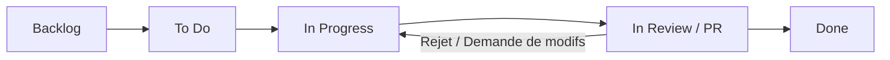

# Guide de Contribution & Workflow d'Équipe

Ce document régit les normes de développement, la stratégie de nommage des branches, le versionnement sémantique (**SemVer**) et le cycle de vie des tickets de fonctionnalités.

---

## 🌿 1. Branching Strategy

Nous utilisons un modèle dérivé de **Git Flow** allégé, optimisé pour les sprints agiles.

### Branches Permanentes
- `main` : Branche de production. Code stable, testé et déployable à tout moment. Chaque commit sur `main` correspond à une version tagguée.
- `develop` : Branche d'intégration continue des fonctionnalités validées.

### Branches Temporaires
Toute nouvelle tâche donne lieu à une branche dérivée de `develop` respectant le pattern suivant :
```text
<type>/<TICKET_ID>-<description-courte-kebab-case>
```

| Type | Rôle | Exemple |
| :--- | :--- | :--- |
| `feature/` | Ajout d'une nouvelle fonctionnalité | `feature/CK-101-click-counter-ui` |
| `fix/` | Correction de bug détecté sur `develop` | `fix/CK-108-cps-calculation-drift` |
| `hotfix/` | Correction urgente directement issue de `main` | `hotfix/CK-200-auth-token-leak` |
| `refactor/` | Restructuration sans altération fonctionnelle | `refactor/CK-115-auth-middleware` |
| `chore/` | Tâche d'outillage, dépendances, CI/CD | `chore/CK-050-setup-eslint-github-actions` |

---

## 🏷️ 2. Semantic Versioning (SemVer)

Les livrables sont taggués selon la spécification [SemVer 2.0.0](https://semver.org/) sous le format :
$$\text{v}\mathbf{X}.\mathbf{Y}.\mathbf{Z}$$

- **MAJOR ($X$)** : Modifications incompatibles avec les versions antérieures (ex: refonte complète des protocoles API, rupture du format de sauvegarde).
- **MINOR ($Y$)** : Ajout de fonctionnalités rétrocompatibles (ex: ajout d'une nouvelle catégorie de bâtiments dans la boutique, système d'achievements).
- **PATCH ($Z$)** : Corrections de bugs rétrocompatibles (ex: correction d'arrondi sur l'affichage du CPS, fix graphique).

*Exemple de cycle :* `v0.1.0` (POC initial) $\rightarrow$ `v0.1.1` (Patch de sync) $\rightarrow$ `v0.2.0` (Boutique) $\rightarrow$ `v1.0.0` (MVP officiel).

---

## 🔄 3. Cycle de Vie des Tickets & Workflow GitHub

Chaque élément de travail est rattaché à une hiérarchie sur l'outil de gestion :
$$\text{EPIC (Parent)} \longrightarrow \text{User Story / Task (Enfant)}$$

### États d'un Ticket (Board Kanban)
1. **Backlog** : Tâche identifiée, priorisée mais non démarrée.
2. **Ready / To Do** : Spécifications claires, critères d'acceptation définis, prête pour le sprint.
3. **In Progress** : Tâche en cours de développement par un membre de l'équipe.
4. **In Review / PR** : Code terminé, Pull Request ouverte en attente de validation par un pair.
5. **Done** : PR approuvée, tests automatisés au vert, branche mergée dans `develop`.



---

## 🤖 4. Automations Définies

Afin de fluidifier le workflow, les automatisations suivantes sont configurées :

1. **Création de branche / Draft PR** : Déplace automatiquement le ticket associé de `To Do` vers `In Progress`.
2. **Ouverture d'une PR** :
   - Déplacement automatique vers `In Review`.
   - Mention du ticket dans la description (`Closes #12` ou `Resolves CK-101`).
3. **Merge de la Pull Request** :
   - Déplacement automatique vers `Done`.
   - Suppression automatique de la branche de feature distante.
4. **CI Automatique (GitHub Actions)** :
   - Exécution des linters et des tests unitaires à chaque `push` et ouverture de PR.
   - Blocage du merge si les tests échouent.

---

## 📝 5. Règles pour les Commits & Pull Requests

### Format des Messages de Commit (Conventional Commits)
```text
<type>(<scope>): <description claire et concise>

[Corps optionnel expliquant le "pourquoi"]

Refs: #<ID_ISSUE>
```
*Exemples :*
- `feat(client): add reactive big cookie click animation (refs #24)`
- `fix(server): prevent negative cookie balance in sync endpoint (refs #31)`

### Règles de Pull Request
- **Relectures requises** : Au moins 1 approbation d'un membre de l'équipe (peer review).
- **Titre clair** : Préfixé par le numéro de ticket (ex: `[CK-101] Composant Big Cookie`).
- **Description** : Résumé des changements + capture d'écran / gif si modification visuelle Front.
