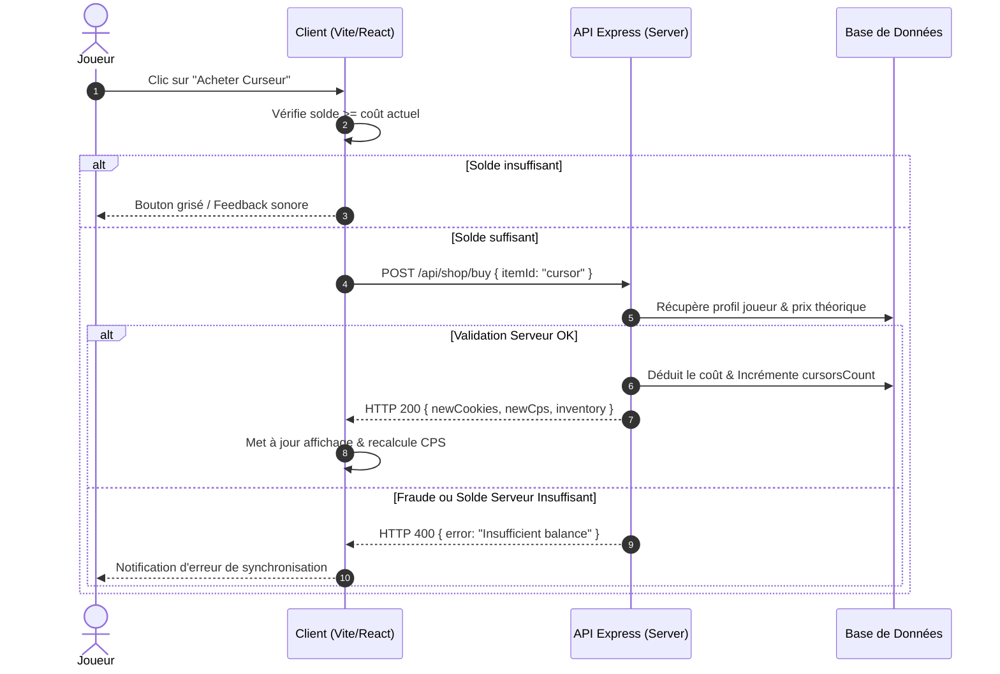

# 📖 Documentation des Fonctionnalités (Feature Specifications)

Ce document détaille les spécifications fonctionnelles et techniques des fonctionnalités majeures du jeu, garantissant une coordination rigoureuse entre Front-End et Back-End.

---

## 🍪 Feature 1 : Moteur de Clic & Production Passive (CPS)

### 1.1 Objectif Fonctionnel
Permettre au joueur d'accumuler des cookies via deux canaux :
1. **Manuel** : Chaque clic sur le Cookie central incrémente le stock de $1$ unité (modulateur de clic de base).
2. **Passif** : Les bâtiments achetés produisent une quantité continue de cookies par seconde ($\text{CPS}$).

### 1.2 Formules & Règles Mathématiques
- **Production continue** : Le Front rafraîchit l'affichage toutes les 100 ms :
  $$\Delta \text{Cookies} = \text{CPS} \times 0.1$$
- **Incrémentation exponentielle des coûts de la boutique** :
  $$\text{Prix}_n = \text{PrixBase} \times (1.15)^n$$
  *(où $n$ est la quantité de bâtiments déjà possédés).*

### 1.3 Contrat d'Interface Front/Back
- Le Front gère l'animation visuelle immédiate (optimistic UI) sans latence réseau.
- Le Back valide la cadence lors des pings de synchronisation.

---

## 🛡️ Feature 2 : Synchronisation Sécurisée & Anti-Triche

### 2.1 Objectif Fonctionnel
Empêcher les joueurs de falsifier leur solde de cookies en exécutant des commandes arbitraires dans la console JavaScript (`cookies = 999999999`).

### 2.2 Règle de Validation Côté Serveur
Lorsqu'une requête arrive sur `POST /api/game/sync`, le serveur calcule la marge de progression maximale permise depuis la dernière synchronisation :
$$\text{DeltaTemps} = t_{\text{actuel}} - t_{\text{dernière\_sync}}$$
$$\text{GainMaximalAutorisé} = (\text{CPS}_{\text{serveur}} \times \text{DeltaTemps}) + (\text{ClicsParSecondeMax} \times \text{DeltaTemps})$$
*(avec une tolérance de clics manuels fixée à 20 clics/seconde).*

- Si $\Delta \text{CookiesReclamés} > \text{GainMaximalAutorisé}$ :
  - La requête est rejetée avec un code `HTTP 400 Bad Request`.
  - Le serveur réinitialise le solde du client avec la dernière valeur saine enregistrée en base.

---

## 🏪 Feature 3 : Catalogue & Achat d'Améliorations (Boutique)

### 3.1 Catalogue Initial du POC
| Bâtiment | Coût de base | Production (+CPS) | Multiplicateur de prix |
| :--- | :--- | :--- | :--- |
| **Curseur (Cursor)** | 15 cookies | +1 CPS | $\times 1.15$ |
| **Grand-mère (Grandma)** | 100 cookies | +5 CPS | $\times 1.15$ |
| **Ferme (Farm)** | 1 100 cookies | +20 CPS | $\times 1.15$ |
| **Mine (Mine)** | 12 000 cookies | +100 CPS | $\times 1.15$ |

### 3.2 Workflow d'Achat


---

## 🔐 Feature 4 : Authentification & Multi-Sessions

### 4.1 Spécifications
- **Identifiants** : Nom d'utilisateur (unique) + mot de passe (haché via `bcrypt` avec 10 tours de salt).
- **Session** : Token **JWT** (JSON Web Token) stocké côté client, avec expiration à 24h.
- **Payload JWT** :
  ```json
  {
    "sub": "usr_948201a",
    "username": "LucasGamer",
    "iat": 1729000000,
    "exp": 1729086400
  }
  ```
- **Sécurité** : Header HTTP requis sur toutes les routes de jeu :
  ```http
  Authorization: Bearer <TOKEN_JWT>
  ```
