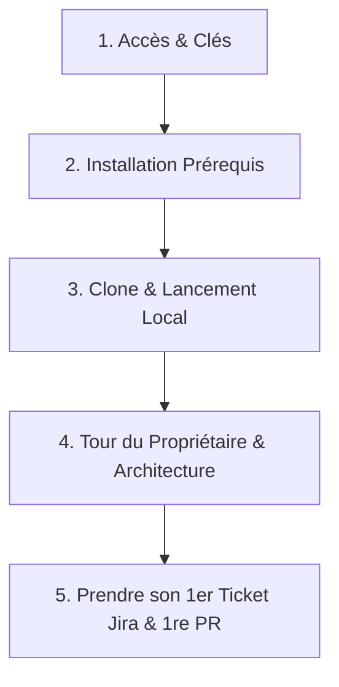

# 🚀 Guide d'Onboarding Développeur (Nouvel Arrivant)

Bienvenue sur le projet **Cookie Clicker Web** !  
Ce guide pas à pas permet à tout nouveau développeur (Front-End, Back-End ou Fullstack) d'être autonome, opérationnel et prêt à merger sa première Pull Request en **moins de 30 minutes**.

---

## ⏱️ Objectif "Day 1" (Les 30 premières minutes)



---

## 🔑 Étape 1 : Accès & Outils Nécessaires
Avant de commencer, vérifiez que vous avez accès à :
1. **Dépôt GitHub** : Droits d'écriture/création de branches sur l'organisation.
2. **Jira Board** : Invitation active sur le projet [Jira Software](https://vanomme.atlassian.net/jira/software/projects/SCRUM/boards/1).
3. **Canaux de communication** : Discord / Teams de l'équipe (canal `#dev-announcements` et `#pr-review`).

---

## 💻 Étape 2 : Prérequis & Environnement Local

Assurez-vous d'avoir installé sur votre machine :
- **Git** : `git --version` ($\ge 2.30$)
- **Node.js** : `node --version` ($\ge 22.5$, recommandé **v22 LTS** ou **v24** pour `node:sqlite` et `node --test`)
- **Éditeur recommandé** : Visual Studio Code avec les extensions recommandées :
  - *ESLint* (dbaeumer.vscode-eslint)
  - *Prettier* (esbenp.prettier-vscode)
  - *Tailwind CSS IntelliSense* (bradlc.vscode-tailwindcss)
  - *Thunder Client* ou *Postman* (pour tester les APIs)

---

## ⚡ Étape 3 : Lancement du Projet en Local (5 min)

### 1. Cloner le projet
```bash
git clone https://github.com/Syrioth/Coordination-front-back.git
cd Coordination-front-back
```

### 2. Démarrer le Serveur Back-End
Dans un premier terminal :
```bash
cd server
npm install
npm run dev
```
> 🩺 Vérifiez que le serveur répond : ouvrez `http://localhost:3001/api/health` ou la documentation Swagger sur `http://localhost:3001/api-docs`.

### 3. Démarrer le Client Front-End
Dans un second terminal :
```bash
cd client
npm install
npm run dev
```
> 🎮 Ouvrez votre navigateur sur `http://localhost:5173`. Vous pouvez cliquer sur le cookie et acheter vos premiers générateurs !

---

## 🗺️ Étape 4 : Tour du Propriétaire & Architecture

```text
├── client/                     # Application Front-End (Vite + Ladle)
│   ├── index.html              # Interface du jeu Cookie Clicker
│   ├── src/                    # Stories Ladle des composants UI isolés
│   └── package.json
│
├── server/                     # Serveur Back-End (Node.js Express)
│   ├── server.js               # API REST, CRUD, anti-triche & gestion d'erreurs
│   ├── swagger.json            # Spécification OpenAPI / Swagger
│   ├── postman_collection.json # Collection Postman prête à l'emploi
│   └── package.json
│
├── PERSONAS.md                 # Vision produit & 3 personas (2 imposés + 1 custom)
├── STORYMAP.md                 # Story Map utilisateur et tranches de release
├── FEATURES_DOCUMENTATION.md   # Spécifications fonctionnelles et formules
├── ERROR_MANAGEMENT.md         # Stratégie Error Handling (UX, DEV/PROD, logs)
├── FRONTEND_COMPONENTS_LADLE.md # Documentation des composants Front (Ladle)
├── CONTRIBUTING.md             # Règles Gitflow, SemVer et cycle des tickets
└── ONBOARDING.md               # Ce guide d'onboarding
```

---

## 🎯 Étape 5 : Votre Premier Ticket & Workflow de PR

1. **Choisir un ticket** : Allez sur le [Board Jira](https://vanomme.atlassian.net/jira/software/projects/SCRUM/boards/1), sélectionnez un ticket dans la colonne **To Do** portant le label `good-first-issue` ou assigné lors du sprint planning.
2. **Assignez-vous le ticket** et passez-le en **In Progress**.
3. **Créer votre branche** depuis `master` selon la convention :
   ```bash
   git checkout master
   git pull origin master
   git checkout -b feature/CK-XXX-nom-de-la-tache
   ```
4. **Développer & Tester** : Faites vos commits en respectant le format Conventional Commits (`feat: ...`, `fix: ...`).
5. **Ouvrir une Pull Request** :
   - Cible : `master` (ou `develop` si actif).
   - Titre : `[CK-XXX] Description de la feature`.
   - Mentionner : `Closes CK-XXX` dans le corps.
6. **Demander une Code Review** : Taggez un membre de l'équipe sur Discord/Teams pour obtenir au moins 1 validation avant merge.

---

## 🆘 Contacts & Aide en Cas de Blocage
- **Lead Tech Front** : Référent composants, CSS et Ladle.
- **Lead Tech Back** : Référent routes API, anti-triche et Swagger.
- Si vous trouvez une ambiguïté dans la documentation, ouvrez directement une PR d'amélioration !
